# Atlabs Noir Motion Comic: a Claude skill

A Claude skill that turns an idea into a finished noir motion comic: a script-to-video story made with the [Atlabs](https://www.atlabs.ai) MCP, then cut with comic panels, speech balloons, typewriter narration, film grain, a three-part score, layered sound design, comic sound words and a neon end card.

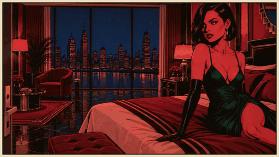

## Example: *Crimson Silk Vengeance* (1:53)

An erotic suspense noir made with this skill.

**[Watch the full film (720p MP4)](examples/Crimson_Silk_Vengeance_720p.mp4)**

| | |
|---|---|
| 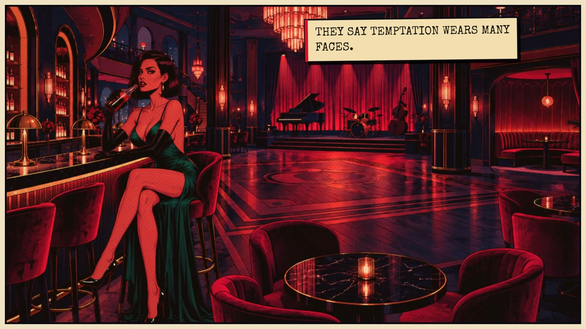 | 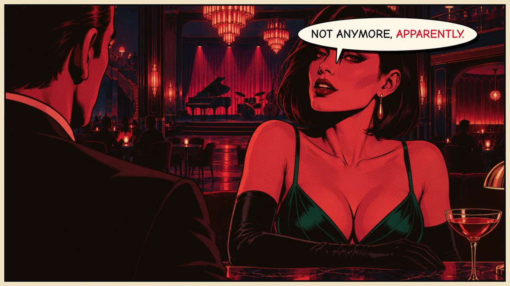 |
| 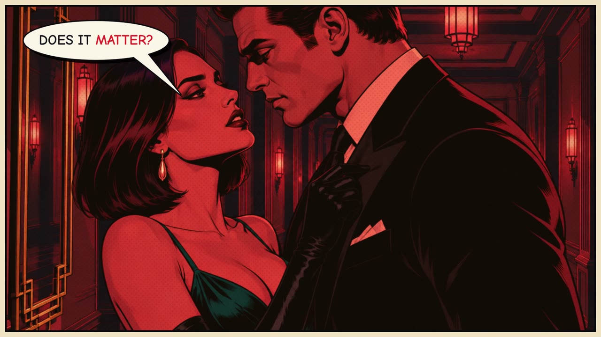 | 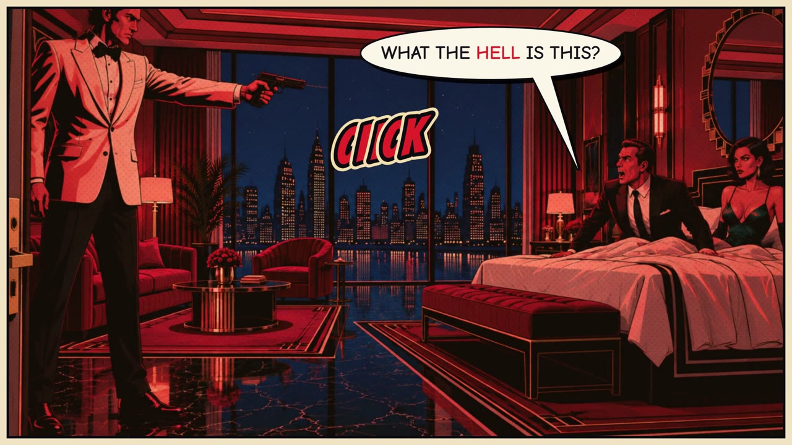 |
| 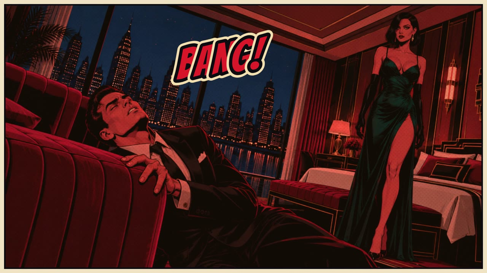 | 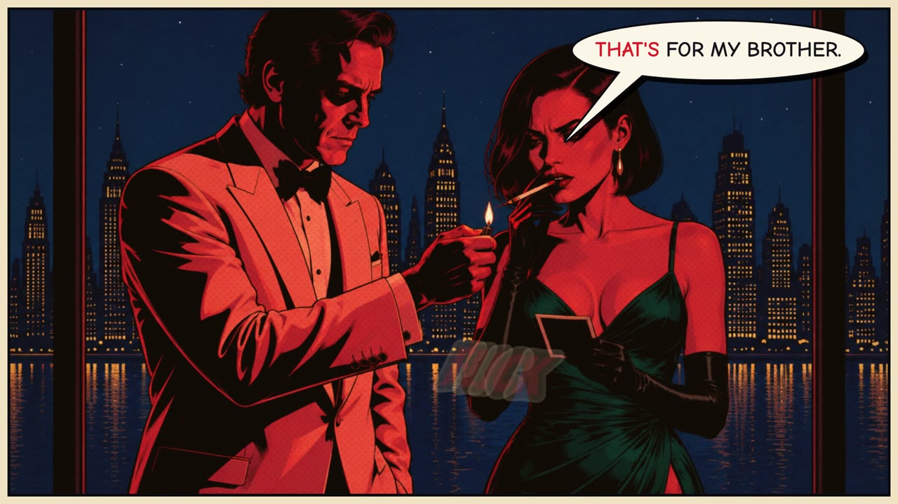 |

### What the skill does

- **Story:** writes a 30 to 35 scene noir script and generates the illustrated scenes and character voices with the Atlabs MCP.
- **Look:** comic panel borders, halftone, film grain, and a slow camera move on every panel.
- **Text:** speech balloons that point at the speaker, with the spoken word lit red. Narration types on in caption boxes.
- **Pacing:** each panel is trimmed tight around its line, with silent beats where the story needs air.
- **Transitions:** wipes on location changes, dissolves for seduction, a dip to black after the kiss, and a white flash on the gunshot.
- **Score:** three generated cues: seduction jazz, then a tension build that cuts dead on the gunshot, then a lonely trumpet coda.
- **Sound design:** about 20 effects, from room tone, ice and heels to a heartbeat, a gun hammer, the gunshot and a zippo, plus comic sound words (CLINK!, CLICK, BANG!).
- **Finish:** a neon end card, a mix at about −14 LUFS, a YouTube export and optional thumbnails.

### Thumbnail examples

| | | |
|---|---|---|
| 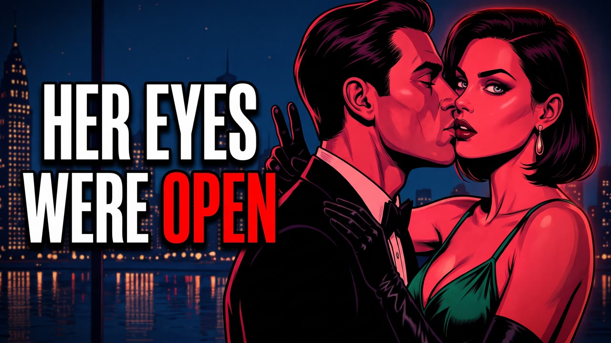 | 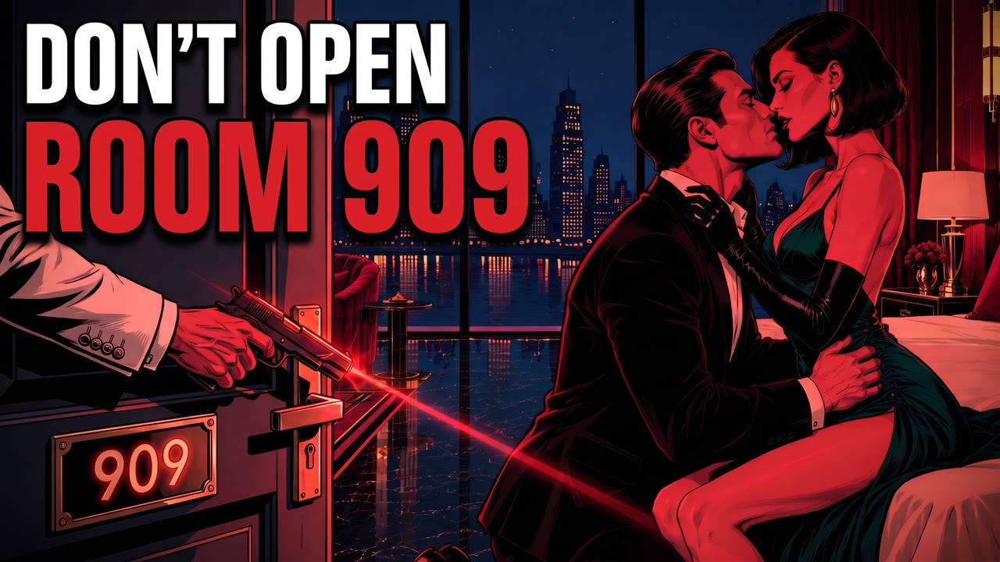 | 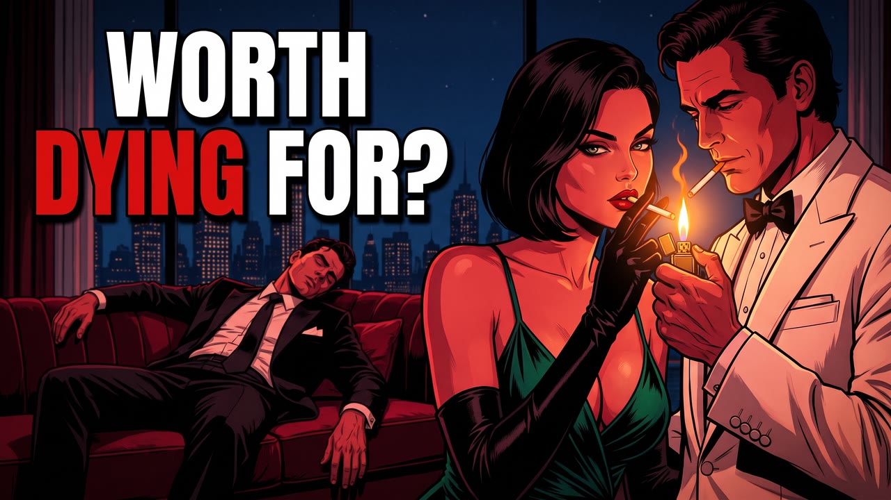 |
| 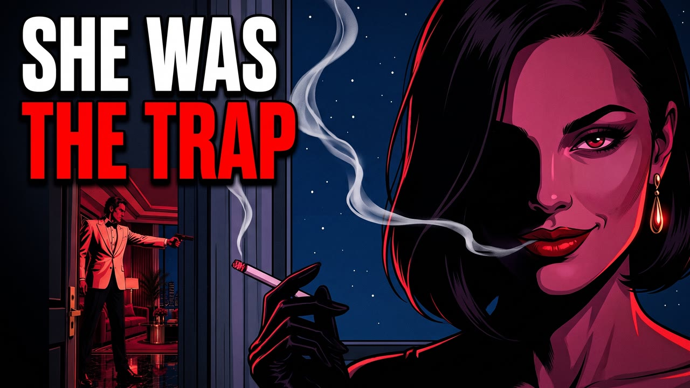 | 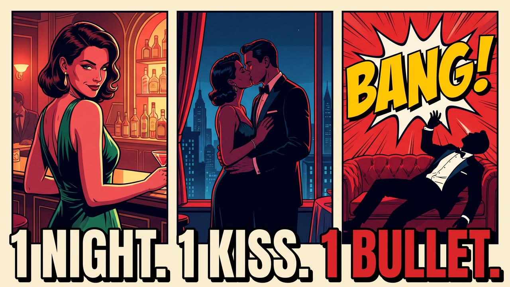 | 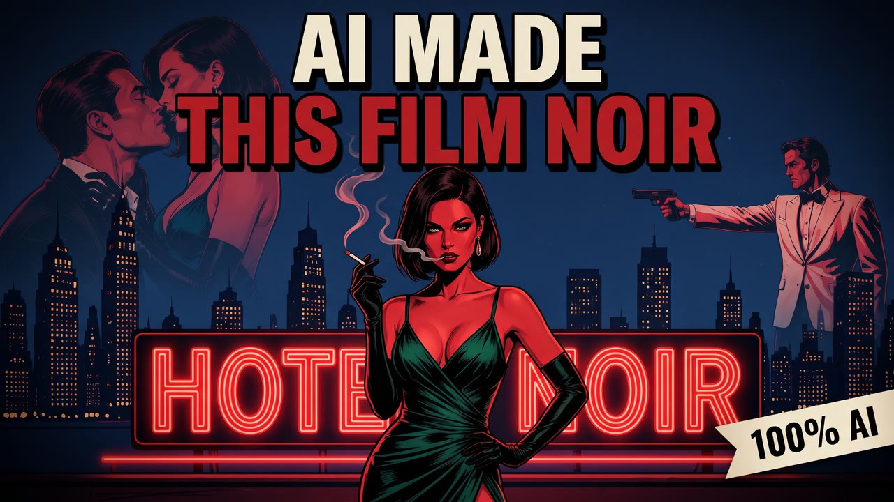 |

## Install

**Claude (claude.ai or desktop):** download [`skills/atlabs-noir-motion-comic/SKILL.md`](skills/atlabs-noir-motion-comic/SKILL.md), zip the `atlabs-noir-motion-comic` folder, and upload it under Settings > Capabilities > Skills.

**Claude Code:**

```bash
git clone https://github.com/Chinmaya123-cyber/atlabs-noir-motion-comic
mkdir -p ~/.claude/skills
cp -r atlabs-noir-motion-comic/skills/atlabs-noir-motion-comic ~/.claude/skills/
```

## Connect the Atlabs MCP

The skill needs the Atlabs MCP connector to create the story, the music and the thumbnails.

- **claude.ai:** Settings > Connectors > Add custom connector. Paste the Atlabs MCP server URL from your Atlabs account, then connect and sign in.
- **Claude Code:** `claude mcp add --transport http atlabs <ATLABS_MCP_URL>`, then run `/mcp` to sign in.

Ask Claude "what's my Atlabs credit balance?" to check the connection.

**Optional:** a sound-effects generator connector (for example ElevenLabs), ffmpeg, and a timeline editor.

## Use it

> Make a noir motion comic about a jazz singer who sets a trap for a gangster, in the style of Crimson Silk Vengeance.

## License

The skill text is MIT licensed. The example video, stills and thumbnails are © Atlabs AI and are shared for reference only.
